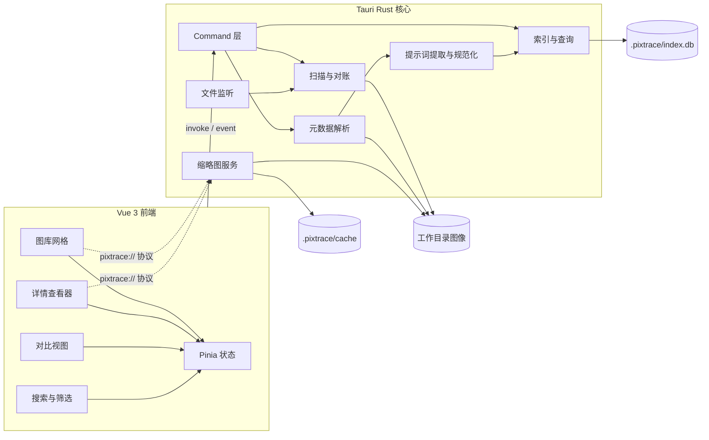

# PixTrace（图迹）项目计划

| 项目 | 内容 |
| --- | --- |
| 产品名 | PixTrace（图迹） |
| 定位 | 本地 AI 生成图像浏览、检索、评级与对比工具 |
| 技术栈 | Tauri 2 + Vue 3 + TypeScript + Rust + SQLite |
| 文档版本 | v0.3（草案） |
| 日期 | 2026-11-12 |
| 目标平台 | 首版 Windows 10/11，架构保持 macOS/Linux 可移植 |
| 分发形态 | 安装版（NSIS/MSI）+ 便携版（zip，解压即用） |

---

## 1. 项目概述

### 1.1 背景

ComfyUI 会把生成参数（API 格式的 `prompt`、UI 格式的 `workflow`）以 PNG 文本块的形式写入输出图片。用户积累大量生成结果后，仅靠文件管理器无法回答以下问题：

- 这张图用了什么提示词、模型、采样器和种子？
- 哪些图用了相同或相近的提示词？效果差异如何？
- 我上次生成过包含某组关键词的图吗？在哪里？
- 哪些图是我评过 4 星以上的？

PixTrace 在工作目录范围内建立本地索引，提供图像浏览、元数据解析、提示词检索、评级和同提示词对比能力。工具只读原图，不修改图片内容。

### 1.2 产品目标

1. 打开一个工作目录后，可以像看图软件一样快速浏览其中的图像。
2. 每张图都能展示从文件中解析出的提示词、生成参数、工作流与文件信息。
3. 支持 1–5 星评级，并按评级筛选、排序。
4. 支持按提示词检索，检索基于本地倒排索引，结果响应快。
5. 支持把相同提示词生成的图像聚合浏览，并进行同步对比。
6. 索引可增量更新，只处理新增或变更的文件。
7. 同时提供安装版与便携版：安装版写入系统应用数据目录，便携版解压即用、数据随程序目录携带，两者共用同一套索引与工作目录格式。

### 1.3 非目标（首版明确不做）

- 不是 AI 图像生成客户端，不连接生成服务，不发起生成任务。
- 不修改原图，不把评级或标签写回图像元数据。
- 不提供云同步、多用户协作、在线分享。
- 不做语义检索、以图搜图、AI 相似度聚类（列入后续版本候选）。
- 不管理工作目录之外的图像。
- 便携版不提供自动更新、文件关联、开机启动等系统级集成。

---

## 2. 用户与核心场景

目标用户：使用 AI 图像生成工具的个人创作者或研究者，本地通常有数千到十万量级的输出图片。

### 场景 A：快速回看与筛选

打开输出目录，网格浏览缩略图，按评级筛出 4–5 星作品，进入大图查看细节并自由缩放。

### 场景 B：复盘生成配方

点开一张图，右侧面板显示正面/负面提示词、模型、LoRA、采样器、步数、CFG、种子、分辨率，以及原始工作流 JSON。

### 场景 C：找回某组提示词的结果

在搜索框输入若干关键词（支持中文与英文），得到命中的图像列表，并可按评级或时间排序。

### 场景 D：同提示词对比

把相同提示词的若干张图放在同一视图，同步缩放和平移，对比细节差异，并查看两次生成的参数差异。

---

## 3. 功能需求

优先级定义：P0 = MVP 必须；P1 = 首个正式版后续迭代；P2 = 远期。

### 3.1 工作目录

| 编号 | 需求 | 优先级 |
| --- | --- | --- |
| W-1 | 通过系统目录选择器打开工作目录 | P0 |
| W-2 | 在工作目录下创建 `.pixtrace/` 存放索引与缓存 | P0 |
| W-3 | 记录最近打开的工作目录 | P1 |
| W-4 | 切换工作目录时保存当前索引，重新加载目标目录 | P0 |
| W-5 | 目录不可写时提供只读降级模式（索引存 AppData） | P1 |

说明：

- 递归扫描工作目录中的受支持图像格式，跳过 `.pixtrace/` 自身和隐藏目录（可配置）。
- 符号链接默认不跟随，避免环路。
- 工作目录可以是移动硬盘或网络盘，但需对 SQLite 的日志模式做检测与降级（见 5.9）。

### 3.2 图像浏览

| 编号 | 需求 | 优先级 |
| --- | --- | --- |
| B-1 | 缩略图网格浏览，支持虚拟滚动 | P0 |
| B-2 | 缩略图尺寸切换（小/中/大） | P1 |
| B-3 | 详情视图自由缩放（滚轮/触控板/按钮）与拖拽平移 | P0 |
| B-4 | 适配窗口、1:1 像素、缩放百分比显示、缩放重置 | P0 |
| B-5 | 详情视图上一张/下一张，保持当前筛选与排序 | P0 |
| B-6 | 键盘导航与快捷键 | P1 |
| B-7 | 全屏查看 | P1 |
| B-8 | 网格按文件名、修改时间、评级排序 | P0 |
| B-9 | 大图（如超过 6000px）使用降采样预览，放大到 100% 以上再加载原图 | P1 |

缩略图与详情图的加载优先级：可视区域 > 相邻一屏 > 预取。滚动离开的生成任务可取消，避免队列堆积。

### 3.3 元数据解析

| 编号 | 需求 | 优先级 |
| --- | --- | --- |
| M-1 | 解析 PNG 的 `tEXt` / `zTXt` / `iTXt` 文本块 | P0 |
| M-2 | 识别 ComfyUI `prompt`（API 格式）与 `workflow`（UI 格式） | P0 |
| M-3 | 从执行图中提取正面提示词、负面提示词 | P0 |
| M-4 | 提取模型、LoRA、采样器、步数、CFG、种子、分辨率等常用参数 | P0 |
| M-5 | 展示原始工作流 JSON（可折叠树） | P0 |
| M-6 | 展示文件信息与 PNG 头信息（尺寸、色彩类型、文件大小、时间） | P0 |
| M-7 | 解析 JPEG/WebP 中的 ComfyUI 元数据（EXIF UserComment / XMP） | P1 |
| M-8 | 只读渲染工作流节点图 | P1 |
| M-9 | 解析失败时展示原始文本块并提供复制 | P0 |

界面中的“EXIF 信息”按用户习惯命名，实际内容包括：PNG 文本块解析结果、IHDR 图像头信息、可选的 `eXIf` 块、文件系统属性。PNG 本身通常不携带传统 EXIF，需在 UI 中避免误导。

### 3.4 评级

| 编号 | 需求 | 优先级 |
| --- | --- | --- |
| R-1 | 为图像设置 1–5 星评级 | P0 |
| R-2 | 点击已选星级可清除评级 | P0 |
| R-3 | 详情视图用数字键 1–5 快速评级 | P1 |
| R-4 | 按评级筛选（等于/大于等于）与排序 | P0 |
| R-5 | 评级乐观更新，写入失败时回滚并提示 | P0 |
| R-6 | 评级按相对路径关联，文件被删除后保留记录 | P0 |
| R-7 | 定期导出 `ratings.json` 快照，用于索引损坏后的恢复 | P1 |

### 3.5 同提示词聚合与对比

| 编号 | 需求 | 优先级 |
| --- | --- | --- |
| G-1 | 以规范化正面提示词哈希分组，展示分组列表与每组数量 | P0 |
| G-2 | 点击分组查看组内图像 | P0 |
| G-3 | 从网格多选 2–4 张图进入对比视图 | P0 |
| G-4 | 对比视图同步缩放与平移 | P0 |
| G-5 | 对比视图展示参数差异（提示词、种子、步数、CFG、采样器、模型、LoRA） | P0 |
| G-6 | 叠加/透明度滑块对比 | P1 |
| G-7 | 近似提示词聚类（SimHash/MinHash） | P2 |

“相同提示词”的定义：对正面提示词做规范化（见 5.5）后，文本（含权重与 LoRA 标记）完全一致，视为同一组。模型、种子、步数等不参与分组，但会显示在参数差异中。

### 3.6 提示词检索

| 编号 | 需求 | 优先级 |
| --- | --- | --- |
| S-1 | 关键词检索正面/负面提示词 | P0 |
| S-2 | 多关键词默认 AND；支持引号短语与 `-排除词` | P0 |
| S-3 | 英文按词检索；中文用分词后检索 | P0 |
| S-4 | 检索结果与评级、模型筛选组合 | P0 |
| S-5 | 结果分页/虚拟滚动，展示命中总数 | P0 |
| S-6 | 搜索框输入防抖，索引未完成时展示进度与部分结果 | P0 |
| S-7 | 字段检索语法 `model:` / `sampler:` / `lora:` / `seed:` / `rating:` | P1 |
| S-8 | 结果中高亮命中的提示词片段 | P2 |

### 3.7 索引维护

| 编号 | 需求 | 优先级 |
| --- | --- | --- |
| I-1 | 打开目录时做快速对账：路径、大小、修改时间 | P0 |
| I-2 | 仅解析新增/变更文件，标记删除文件 | P0 |
| I-3 | 后台工作线程池解析元数据并批量写库 | P0 |
| I-4 | 索引进度、完成量、剩余时间、可取消 | P0 |
| I-5 | 解析器版本升级后触发全量重解析 | P0 |
| I-6 | 手动“重建索引” | P1 |
| I-7 | 文件监听（防抖）触发增量对账 | P1 |
| I-8 | 缩略图按需生成并缓存，可配置容量上限 | P0 |

“按需更新”的两层含义：

1. 不做无意义的全量重扫，只处理指纹变化的文件。
2. 缩略图、原始工作流 JSON 等大对象按需生成/读取，不在索引阶段全部预生成。

注意：提示词检索需要全量元数据，首次打开大目录时后台解析无法完全省略；但浏览不依赖解析完成，索引期间即可看图。

### 3.8 分发形态

| 编号 | 需求 | 优先级 |
| --- | --- | --- |
| D-1 | 提供 Windows 安装版（NSIS 按用户安装，无需管理员权限；可选 MSI） | P0 |
| D-2 | 提供 Windows 便携版（zip 解压即用，不写注册表） | P0 |
| D-3 | 同一份二进制根据运行位置或标记文件自动判定模式，功能一致 | P0 |
| D-4 | 便携版的应用数据、日志、WebView2 用户数据写入程序目录 `data/` | P0 |
| D-5 | 便携版启动时检测 WebView2 运行时，缺失时给出明确提示 | P0 |
| D-6 | 安装版支持自动更新；便携版手动替换，不自动更新 | P1 |
| D-7 | 两种形态共用 `.pixtrace` 数据格式，工作目录可在两者间直接切换 | P0 |
| D-8 | 便携版可在 U 盘/移动硬盘运行，工作目录可随盘迁移 | P1 |

---

## 4. 非功能需求

| 类别 | 目标 |
| --- | --- |
| 容量 | 单工作目录设计容量 100,000 张；验收测试 50,000 张 |
| 快速对账 | SSD 上不低于 1,000 文件/秒（只读 stat，不解码） |
| 元数据解析 | 8 工作线程下不低于 200 文件/秒（只读 PNG 文本块） |
| 检索性能 | 100,000 张规模下 P95 < 100ms |
| 缩略图 | 320px WebP 单张生成 < 80ms（常规 1–4MB PNG） |
| 界面 | 网格滚动 60fps；缩放/平移无明显掉帧 |
| 内存 | 常规浏览 RSS < 500MB；缩略图节点按视口回收 |
| 磁盘 | 索引 < 100MB/10 万张（不含缩略图）；缩略图缓存默认上限 2GB，LRU 淘汰 |
| 可靠性 | 异常文件不阻塞整体索引；进程崩溃后可恢复；派生数据可重建 |
| 安全 | 仅访问当前工作目录；不联网；不执行图像内嵌内容 |
| 兼容 | Windows 10/11 优先；路径与协议层避免平台绑定 |
| 分发 | 安装版与便携版共用同一代码与数据格式；便携版不依赖注册表，除程序目录外不写系统盘 |

---

## 5. 技术方案

### 5.1 技术选型

| 层 | 选择 | 理由 |
| --- | --- | --- |
| 桌面壳 | Tauri 2 | 安装包小、内存占用低、Rust 端适合文件扫描与解析 |
| 前端 | Vue 3 + TypeScript + Vite + Pinia + Vue Router | 组合式 API 适合复杂视图状态；虚拟滚动与缩放组件易实现 |
| 后端 | Rust | 高吞吐文件遍历、低开销 PNG 解析、可控线程池 |
| 数据库 | SQLite（`rusqlite`） | 单文件、可随目录迁移；FTS5 即磁盘倒排索引 |
| 元数据 | 自研 PNG 块读取器（`png` crate 或手写流式读取） | 只读文本块，无需解码像素，速度快 |
| 缩略图 | `image` + `fast_image_resize` + WebP 编码 | 成熟稳定，质量控制方便 |
| 文件监听 | `notify` + 防抖 | 增量更新 |
| 并发 | 专用扫描线程 + 有界工作池 + 单写连接 | 避免 SQLite 写竞争，避免阻塞 Tauri 异步运行时 |

UI 组件库可选 Naive UI 或自研轻量组件。图像浏览类界面自定义样式较多，建议只引入基础控件（弹窗、下拉、提示），核心网格与查看器自研。

### 5.2 总体架构



关键原则：前端不直接接触文件路径。图像与缩略图通过自定义协议按 `image_id` 获取，由 Rust 侧校验归属工作目录并读取文件。

### 5.3 目录结构

```text
pixtrace/
├─ docs/
│  └─ PROJECT_PLAN.md
├─ src/                         # Vue 3 前端
│  ├─ App.vue
│  ├─ router/
│  ├─ stores/                   # Pinia: workspace / library / selection / compare
│  ├─ views/
│  │  ├─ WelcomeView.vue
│  │  ├─ LibraryView.vue
│  │  ├─ DetailView.vue
│  │  ├─ CompareView.vue
│  │  └─ PromptGroupsView.vue
│  ├─ components/
│  │  ├─ layout/
│  │  │  ├─ AppShell.vue
│  │  │  ├─ TopToolbar.vue
│  │  │  ├─ FilterSidebar.vue
│  │  │  └─ StatusBar.vue
│  │  ├─ library/
│  │  │  ├─ VirtualImageGrid.vue
│  │  │  ├─ ImageCard.vue
│  │  │  ├─ SelectionActionBar.vue
│  │  │  └─ IndexStatusBar.vue
│  │  ├─ detail/
│  │  │  ├─ DetailOverlay.vue
│  │  │  ├─ ZoomPanViewer.vue
│  │  │  ├─ MetadataPanel.vue
│  │  │  ├─ PromptPanel.vue
│  │  │  ├─ ParameterPanel.vue
│  │  │  ├─ WorkflowJsonViewer.vue
│  │  │  ├─ FileInfoPanel.vue
│  │  │  └─ Filmstrip.vue
│  │  ├─ compare/
│  │  │  ├─ ComparePane.vue
│  │  │  ├─ DiffTable.vue
│  │  │  └─ ViewportSyncToggle.vue
│  │  └─ common/
│  │     ├─ RatingStars.vue
│  │     ├─ SearchBar.vue
│  │     ├─ EmptyState.vue
│  │     └─ ErrorBadge.vue
│  ├─ composables/              # useZoomPan / useVirtualGrid / useKeyboard
│  └─ api/                      # invoke 封装、事件订阅、协议 URL 构造
├─ src-tauri/
│  ├─ src/
│  │  ├─ main.rs
│  │  ├─ lib.rs
│  │  ├─ commands/              # open_workspace / list_images / search / set_rating ...
│  │  ├─ scanner/               # 遍历、指纹、对账
│  │  ├─ metadata/              # parser trait + png / jpeg(后续)
│  │  ├─ prompt/                # 图遍历、提取、规范化、分词、哈希
│  │  ├─ index/                 # db、migrations、fts、写入队列
│  │  ├─ thumbs/                # 生成、缓存、LRU
│  │  ├─ protocol.rs            # pixtrace:// 图像与缩略图协议
│  │  └─ watcher.rs
│  ├─ tests/
│  ├─ tauri.conf.json
│  ├─ tauri.portable.conf.json
│  └─ Cargo.toml
├─ scripts/
│  └─ package-portable.mjs        # 组装便携版 zip
├─ package.json
├─ vite.config.ts
└─ README.md
```

### 5.4 ComfyUI 元数据解析

#### 5.4.1 PNG 文本块

PNG 由 8 字节签名与若干块组成，每块结构为：长度(4) + 类型(4) + 数据 + CRC(4)。需要读取：

- `tEXt`：Latin-1，`keyword\0text`。
- `zTXt`：`keyword\0` + 1 字节压缩方法 + zlib 压缩文本。
- `iTXt`：`keyword\0` + 1 字节压缩标志 + 1 字节压缩方法 + `language\0` + `translated_keyword\0` + 文本（UTF-8，按标志决定是否 zlib 压缩）。
- `IHDR`：宽、高、位深、色彩类型。
- `eXIf`：若存在则交给 EXIF 解析器（P1）。

实现要点：

- 不解码 `IDAT`，按块长度直接 seek 跳过，保证大图解析速度。
- 文本块可能位于 `IDAT` 前后，需扫描到 `IEND`。
- 对单个文本块大小设上限（如 32MB），避免异常文件造成内存问题。
- 对 `prompt` / `workflow` 的 JSON 解析设置大小与深度限制，防止恶意或损坏数据。
- 解析结果保留原始字节的候选，解析失败时仍可展示文本。

ComfyUI 的 `SaveImage` 节点通常写入两个键：

- `prompt`：API 格式，`{ "<node_id>": { "class_type": "...", "inputs": { ... } } }`，连线表示为 `[node_id, output_index]`。
- `workflow`：UI 格式，包含 `nodes`、`links`、`groups` 等，适合展示与后续节点图渲染。

部分自定义节点还会写 `parameters`（A1111 风格）或其他键，作为兜底解析。

#### 5.4.2 正面提示词提取算法

API 格式的执行图最适合提取实际生效的参数。采用“从采样器反向遍历”的启发式：

```text
extract(api_prompt):
  samplers = nodes where class_type in {
    KSampler, KSamplerAdvanced, SamplerCustom, SamplerCustomAdvanced, ...
  }
  if samplers is empty:
    return fallback_all_text_nodes(api_prompt)

  negatives = closure(samplers[*].inputs.negative)   # 解析 [node_id, slot] 链接
  positives = closure(
    samplers[*].inputs.positive,
    samplers[*].inputs.conditioning,                 # Flux / 自定义采样器
    guider_of(samplers[*]).inputs.conditioning       # BasicGuider
  )

  pos_nodes = positives - negatives                  # 避免负向文本被误算
  texts = []
  for node in traversal_order(pos_nodes):            # 从采样器向上游广度优先
    for field in ["text", "text_g", "text_l", "prompt", "positive", "string", "value"]:
      if node.inputs[field] is string:
        texts.append(node.inputs[field])
  return join(texts, "\n")
```

补充规则：

- 链接字段可能是字符串字面量、也可能指向 `PrimitiveNode` / `String` 等节点，需递归解析到字面量。
- `CLIPTextEncodeSDXL` 的 `text_g` 与 `text_l` 都要收集。
- `ConditioningCombine`、`ConditioningAverage`、`ControlNetApplyAdvanced` 等节点有多个条件输入，需继续向上遍历，但不能跨过负向分支。
- 若同一文本节点既出现在正向又出现在负向闭包中，从正向结果中剔除。
- 若采样器类型未知或图结构异常，回退为“收集所有文本编码节点”，标记 `parse_status = partial`。
- 无 API `prompt` 但有 `workflow` 时，按 UI 图的连线从采样器的 positive 输入回溯。
- 两者都没有但存在 A1111 风格 `parameters` 时，按 `Negative prompt:`、`Steps:` 等分隔符解析。

界面同时展示“提取结果”和“原始文本节点列表”，让用户在复杂工作流下可以自行核对，避免把启发式结果伪装成绝对正确的答案。

#### 5.4.3 参数提取

从采样器与其上游节点提取：

| 参数 | 来源 |
| --- | --- |
| 模型 | `CheckpointLoaderSimple.ckpt_name`、`UNETLoader.unet_name` |
| LoRA | `LoraLoader` 链的 `lora_name` / `strength_model` |
| 采样器 | `KSampler.sampler_name` / `scheduler` |
| 步数 | `KSampler.steps` 或 `BasicScheduler.steps` |
| CFG | `KSampler.cfg` |
| 种子 | `KSampler.seed` / `noise_seed`（Flux 路径） |
| 分辨率 | 采样器 latent 的 `width` / `height`，或 `EmptyLatentImage` |
| 重绘/降噪 | `denoise` |

多采样器工作流（如高清修复、SDXL Refiner）取主采样器为主，其余在参数面板中折叠展示。

### 5.5 提示词规范化、分词与倒排索引

#### 5.5.1 规范化

用于分组哈希与检索文本生成：

1. Unicode NFC 归一化。
2. 去除转义反斜杠：`\(` → `(`，`\)` → `)`。
3. 保留权重语义用于分组，但在检索文本中去掉权重数值：`(masterpiece:1.2)` → 分组保留、检索词为 `masterpiece`。
4. 解析并单独记录 `<lora:name:0.8>`，检索时 `name` 进入 LoRA 字段。
5. 处理 `[a:b:0.5]` 交替语法与 `BREAK` 分隔符，至少不破坏其余文本。
6. 折叠连续空白为单空格，去除首尾空白。
7. 分组哈希对大小写不敏感（统一转小写）。

分组哈希：

```text
prompt_norm = normalize(positive_prompt)      # 保留权重与 LoRA 标记，统一小写
prompt_hash = blake3(prompt_norm)             # 十六进制，写入 image.prompt_hash
```

#### 5.5.2 分词

- 英文与数字：按 Unicode 字母/数字切分，保留下划线，统一小写，丢弃纯标点。
- 中文/日文/韩文：使用 `jieba-rs` 分词后用空格连接。FTS5 的 `unicode61` 不会对连续 CJK 文本分词，直接索引会导致整段成为一个 token，因此必须先分词。
- 变体：保留原始词形，不做词干化（stemming）。提示词中的词形差异通常有语义，且用户更习惯原词检索。
- 检索文本示例：`masterpiece, best quality, (1girl:1.2)` → `masterpiece best quality 1girl`。

#### 5.5.3 倒排索引实现

采用 SQLite FTS5 作为倒排索引引擎。FTS5 本身即磁盘上的倒排索引，支持 BM25 排序、短语查询与前缀查询，避免自研索引的维护成本与正确性风险。

不采用自研 `term → posting` 表的原因：

- 需要自行实现查询解析、排序、删除维护与并发写入。
- FTS5 已覆盖首版全部检索语义，且性能满足 10 万级。
- 若后续需要权重感知排序（例如 `(word:1.5)` 影响相关度），可在检索文本中加入重复词或改用自定义排序，不必更换存储。

可选优化：使用 `content=''` 的 contentless 表节省空间，但删除与重建语法更复杂；首版使用普通 FTS5 表，应用层在同一事务内维护 `INSERT` / `DELETE`，实现简单。

#### 5.5.4 检索语法

首版：

- `word1 word2` → AND
- `"exact phrase"` → 短语
- `-word` → 排除
- 全部转为 FTS5 查询表达式，用户输入中的 FTS 特殊字符需转义，避免语法错误。

P1：

- `model:sdxl`、`sampler:euler`、`lora:detail`、`seed:12345`、`rating:>=4`
- 检索结果按 BM25 或时间/评级排序切换。

### 5.6 增量更新与按需生成

#### 5.6.1 打开工作目录

1. 规范化并校验目录，创建 `.pixtrace/`。
2. 打开或创建 `index.db`，执行 schema 迁移。
3. 读取 `parser_version`；若与当前解析器不一致，将所有记录标记为待重解析。
4. 快速递归遍历，仅获取相对路径、文件大小、修改时间（不打开文件）。
5. 与数据库对比，生成三类任务：新增、变更、删除。
6. 立即返回工作目录信息与首批文件列表；后台开始解析队列。

#### 5.6.2 解析队列

- 有界队列 + 工作线程池（默认 `min(8, CPU 核数)`）。
- 每个文件：读取 PNG 文本块 → 解析 JSON → 提取提示词与参数 → 规范化/分词/哈希。
- 批量写库：每 100–500 条一个事务，同时更新 `image` 与 `image_fts`。
- 进度通过 Tauri 事件推送：`scan:progress { total, done, failed, phase }`。
- 支持取消：设置原子标志，工作线程在任务边界退出，已写入的批次保留。
- 单文件失败只记录 `parse_error`，不阻塞队列。

#### 5.6.3 变更检测与文件监听

- 指纹 = 相对路径 + 文件大小 + 修改时间（纳秒级）。
- 任一变化即视为变更，重新解析并更新索引。
- 文件删除：置 `deleted_at`，从 FTS 删除对应行；评分记录保留。
- P1 引入 `notify` 递归监听，2 秒防抖后只对受影响路径做对账。网络盘监听不可靠，提供手动刷新。

#### 5.6.4 缩略图

- 缓存路径：`.pixtrace/cache/thumbs/<hash前2位>/<hash>.webp`。
- 缓存键包含相对路径、大小、修改时间与目标尺寸，源文件变化自动失效。
- 尺寸：网格 320px；详情预览 1024px（P0 只做网格缩略图亦可）。
- 视口优先的有界任务队列；滚出视口的未完成任务取消。
- 容量上限默认 2GB，按最近访问时间 LRU 淘汰；设置页可调整或清空。

#### 5.6.5 索引状态

前端展示：总文件数、已解析数、失败数、当前阶段、预计剩余时间、索引库大小。检索时若索引未完成，展示“索引中”提示并随事件刷新结果。

### 5.7 数据模型

```sql
PRAGMA journal_mode = WAL;
PRAGMA synchronous = NORMAL;
PRAGMA foreign_keys = ON;

-- schema 版本使用 PRAGMA user_version 管理
-- 派生数据可重建；评分是用户数据，需快照备份

CREATE TABLE meta (
  key   TEXT PRIMARY KEY,
  value TEXT NOT NULL
);  -- parser_version / workdir_root / created_at

CREATE TABLE image (
  id               INTEGER PRIMARY KEY,
  rel_path         TEXT    NOT NULL UNIQUE,
  file_size        INTEGER NOT NULL,
  mtime_ns          INTEGER NOT NULL,
  width            INTEGER,
  height           INTEGER,
  format           TEXT    NOT NULL DEFAULT 'png',
  parse_status     TEXT    NOT NULL DEFAULT 'pending',
                   -- pending | ok | partial | no_meta | error | ignored
  parse_error      TEXT,
  positive_prompt  TEXT,
  negative_prompt  TEXT,
  prompt_hash      TEXT,
  search_positive  TEXT,   -- 分词后的检索文本
  search_negative  TEXT,
  model_name       TEXT,
  loras            TEXT,   -- 逗号分隔 name:weight
  sampler          TEXT,
  steps            INTEGER,
  cfg              REAL,
  seed             INTEGER,
  indexed_at       INTEGER,
  deleted_at       INTEGER
);

CREATE INDEX idx_image_prompt_hash
  ON image(prompt_hash) WHERE deleted_at IS NULL;
CREATE INDEX idx_image_mtime
  ON image(mtime_ns) WHERE deleted_at IS NULL;

CREATE TABLE image_asset (
  image_id      INTEGER PRIMARY KEY REFERENCES image(id) ON DELETE CASCADE,
  prompt_json   BLOB,   -- zstd 压缩的 API 格式 JSON
  workflow_json BLOB,   -- zstd 压缩的 UI 格式 JSON
  raw_text      BLOB    -- 解析失败时的原始文本块
);

CREATE TABLE image_rating (
  rel_path   TEXT PRIMARY KEY,   -- 按路径关联，文件删除后保留
  stars      INTEGER NOT NULL CHECK (stars BETWEEN 1 AND 5),
  updated_at INTEGER NOT NULL
);

CREATE VIRTUAL TABLE image_fts USING fts5(
  positive,
  negative,
  model,
  loras,
  tokenize = 'unicode61 remove_diacritics 2'
);
-- rowid 与 image.id 对齐；应用层在同一事务中写入/删除
```

说明：

- `image_asset` 单独存放，避免主表行过大影响列表查询。
- 原始 JSON 压缩后通常从数十 KB 降到几 KB。
- 评分单独建表，与派生数据解耦，便于导出快照。
- 删除文件采用软删除，保留评分；重建索引时可清理长期不存在的记录（P1）。

典型查询：

```sql
-- 检索 + 评级过滤
SELECT i.id, i.rel_path, i.positive_prompt, r.stars
FROM image_fts f
JOIN image i ON i.id = f.rowid
LEFT JOIN image_rating r ON r.rel_path = i.rel_path
WHERE image_fts MATCH ?
  AND i.deleted_at IS NULL
  AND (:min_rating IS NULL OR r.stars >= :min_rating)
ORDER BY rank
LIMIT ? OFFSET ?;

-- 同提示词分组
SELECT prompt_hash, COUNT(*) AS n, MIN(id) AS cover_id, MIN(positive_prompt) AS sample
FROM image
WHERE deleted_at IS NULL AND prompt_hash IS NOT NULL
GROUP BY prompt_hash
ORDER BY n DESC;
```

### 5.8 前端设计

#### 5.8.1 整体布局

桌面端采用三栏式结构：顶部全局工具栏、左侧导航与筛选、中间主内容、右侧元数据检查器、底部状态栏。图库是主视图；详情以覆盖层打开，对比为全屏视图。

**图库（主视图）**

```text
┌──────────────────────────────────────────────────────────────────────┐
│ PixTrace   D:\outputs\2026      [ 搜索提示词…        ]  排序▾ 评级▾  ⚙ │
├──────────────┬───────────────────────────────────────────────────────┤
│ 图库          │  ┌────┐ ┌────┐ ┌────┐ ┌────┐ ┌────┐ ┌────┐          │
│  全部图片     │  │ ★  │ │    │ │ ★★ │ │    │ │    │ │ ★★★│          │
│  未评级       │  └────┘ └────┘ └────┘ └────┘ └────┘ └────┘          │
│  ★5 ★4 ★3…   │  ┌────┐ ┌────┐ ┌────┐ ┌────┐ ┌────┐ ┌────┐          │
│  提示词分组    │  │    │ │    │ │    │ │    │ │    │ │    │          │
│              │  └────┘ └────┘ └────┘ └────┘ └────┘ └────┘          │
│ 筛选          │                                                       │
│  模型 ▾       │                                                       │
│  采样器 ▾     │                                                       │
│  含工作流 ☑    │                                                       │
├──────────────┴───────────────────────────────────────────────────────┤
│ 12,345 张 · 索引 8,200/12,345 ███████░░ 65% · 缓存 1.2 GB             │
└──────────────────────────────────────────────────────────────────────┘
```

**详情（覆盖层）**

```text
┌──────────────────────────────────────────────────────────────────────┐
│ ← 返回   00042.png   ★★★★☆   [加入对比] [全屏] [⋯]                  │
├──────────────────────────────────────────┬───────────────────────────┤
│                                          │ 提示词 | 参数 | 工作流 | 文件│
│                                          │                           │
│            图像查看区                     │ 正面提示词                 │
│       滚轮缩放 / 拖拽平移 / 双击 1:1      │ masterpiece, best quality… │
│                                          │ [复制]                    │
│                                          │ 负面提示词                 │
│                                          │ lowres, bad anatomy…      │
│                                          │ [复制]                    │
│                                          │ 模型   SDXL base 1.0       │
│                                          │ 采样器 euler / normal     │
│                                          │ 步数 28   CFG 7   Seed … │
├──────────────────────────────────────────┴───────────────────────────┤
│ ◀   [缩略图] [缩略图] [当前] [缩略图] [缩略图]   ▶                  │
└──────────────────────────────────────────────────────────────────────┘
```

**对比（全屏）**

```text
┌──────────────────────────────────────────────────────────────────────┐
│ 对比 4 张    [同步缩放 ✓]   [2×2 ▾]   [叠加]                       │
├────────────────────────┬─────────────────────────────────────────────┤
│                        │                                             │
│         图 A           │                图 B                         │
│                        │                                             │
├────────────────────────┼─────────────────────────────────────────────┤
│                        │                                             │
│         图 C           │                图 D                         │
│                        │                                             │
├────────────────────────┴─────────────────────────────────────────────┤
│ 差异：Seed 123/456 · Steps 28/30 · CFG 7/7.5 · 其余相同               │
└──────────────────────────────────────────────────────────────────────┘
```

布局规格：

| 区域 | 尺寸与行为 |
| --- | --- |
| 顶部工具栏 | 高 48px；工作目录、搜索框、排序、评级筛选、设置 |
| 左侧栏 | 默认 220px，可折叠；折叠后网格占满 |
| 主内容 | 自适应；虚拟网格或分组卡片流 |
| 右侧检查器 | 详情视图默认 360px，可折叠；折叠后图像区最大化 |
| 底部状态栏 | 高 28px；总数、索引进度、缓存占用 |
| 窗口 | 默认 1280×800，最小 1024×640；窄窗口时左右栏改为抽屉覆盖 |
| 主题 | 默认深色中性底，支持浅色；图像区背景可独立设为黑/深灰/棋盘格 |

- 详情采用覆盖层而非独立页面，返回时保留网格滚动位置、筛选与选中状态。
- 右侧检查器标签页：提示词 / 参数 / 工作流 / 文件；工作流首版为可折叠 JSON 树，P1 增加节点图。
- 底部胶片条沿用当前筛选与排序，左右方向键切换。
- 对比视图支持 2/3/4 窗格与 2×2 布局；同步缩放可单独关闭；参数差异只高亮不同项；从同提示词分组进入时默认预选该组前 4 张。
- 提示词分组与图库共用左栏，主区切换为分组卡片流（代表图、提示词摘要、数量）；点击进入组内网格，不增加新的路由层级。

#### 5.8.2 视图

| 视图 | 内容 |
| --- | --- |
| 欢迎页 | 打开目录、最近目录、简介 |
| 图库 | 顶部工具栏、左侧导航与筛选、虚拟网格、底部索引状态条 |
| 详情 | 覆盖层：顶部操作条、中央缩放查看器、右侧检查器、底部胶片条 |
| 对比 | 全屏：2–4 个同步查看器、参数差异表 |
| 提示词分组 | 共用左栏，主区为分组卡片流、组内数量、代表图 |

#### 5.8.3 区域与交互

| 区域 | 交互 |
| --- | --- |
| 顶部工具栏 | 搜索框居中偏左，是核心入口；支持 `-排除词`、引号短语，P1 增加字段语法 |
| 左侧栏 | 导航（全部 / 未评级 / 星级 / 提示词分组）+ 筛选（模型、采样器、含工作流） |
| 网格卡片 | 无边框缩略图；悬停显示星级、复选框、文件名；选中项描边高亮 |
| 多选操作条 | 选中后浮出：已选数量、对比、批量评级、取消 |
| 详情操作条 | 返回、文件名、评级、加入对比、全屏、更多 |
| 检查器 | 标签页切换；正面/负面提示词各带复制按钮；参数以键值表展示 |
| 胶片条 | 当前项居中，滚动同步；点击或方向键切换 |
| 状态栏 | 索引进度可点击查看详情；缓存占用可跳转设置 |

#### 5.8.4 虚拟网格

- 固定卡片尺寸，按行虚拟化，只渲染视口内及上下各一屏。
- 卡片位置用绝对定位，滚动容器只负责滚动，避免整体重排。
- 缩略图通过 `pixtrace://thumb/<id>?v=<mtime>` 加载，版本参数保证缓存失效。
- 图片使用 `decoding="async"`；离开视口一定距离后卸载 `src`，控制内存。
- 选中态支持单选、多选（Ctrl/Cmd + 点击）、范围选择（Shift + 点击）。

#### 5.8.5 缩放与平移

以容器左上角为原点，使用 `translate(tx, ty) scale(s)`：

```text
onWheel(e):
  x = e.clientX - rect.left           // 容器局部坐标
  y = e.clientY - rect.top
  k = 0.0015
  s2 = clamp(s * exp(-e.deltaY * k), sMin, sMax)
  ratio = s2 / s
  tx2 = x - (x - tx) * ratio          // 以光标为锚点
  ty2 = y - (y - ty) * ratio
```

- 拖拽平移使用 Pointer Events，配合 `pointercapture`。
- 双击在“适应窗口”和“100%”之间切换。
- 放大超过 200% 时可切换 `image-rendering: pixelated`，方便检查像素。
- 平移范围允许少量越界，但松手后回弹，防止图像完全移出视野。
- 触控板双指缩放通过 `ctrlKey + wheel` 识别。

#### 5.8.6 同步对比

各窗格共享归一化视口状态 `{ cx, cy, scale }`，其中 `cx/cy` 是图像宽高的比例坐标。每个窗格按自身尺寸换算 `translate`，从而支持不同分辨率图像同步对比。同步开关可独立关闭。

#### 5.8.7 状态管理

Pinia 按领域拆分：

- `workspace`：根目录、索引状态、事件订阅。
- `library`：当前查询、筛选、排序、分页缓存、选中项。
- `detail`：当前图像、元数据、上一张/下一张。
- `compare`：选中集合、同步视口、差异结果。

列表数据按页缓存，查询变化时清空；索引更新事件到达时，若当前查询受影响则刷新首页并保留滚动位置（P1）。

#### 5.8.8 快捷键（P1）

| 键 | 行为 |
| --- | --- |
| 方向键 | 网格/详情切换图像 |
| `+` / `-` / `0` / `1` | 放大 / 缩小 / 适应窗口 / 1:1 |
| `1`–`5` | 设置评级（详情视图） |
| `Space` | 快速预览 |
| `Esc` | 关闭详情或对比 |
| `C` | 将选中项加入对比 |

#### 5.8.9 组件拆分

| 区域 | 组件 |
| --- | --- |
| 应用框架 | `AppShell`、`TopToolbar`、`FilterSidebar`、`StatusBar` |
| 图库 | `VirtualImageGrid`、`ImageCard`、`SelectionActionBar`、`IndexStatusBar` |
| 详情 | `DetailOverlay`、`ZoomPanViewer`、`MetadataPanel`、`PromptPanel`、`ParameterPanel`、`WorkflowJsonViewer`、`FileInfoPanel`、`Filmstrip` |
| 对比 | `ComparePane`、`DiffTable`、`ViewportSyncToggle` |
| 分组 | `PromptGroupCard` |
| 通用 | `RatingStars`、`SearchBar`、`EmptyState`、`ErrorBadge` |

`MetadataPanel` 只负责标签页容器与数据获取，四个标签内容由对应子组件渲染。

### 5.9 安全与健壮性

- 自定义协议 `pixtrace://` 只接受 `image_id`，Rust 侧查库得到路径并校验规范化后仍位于工作目录内，拒绝路径穿越。
- 前端不接收绝对路径；错误信息中如包含路径，仅用于本地显示。
- 图像元数据视为不可信输入：限制 JSON 大小与嵌套深度，不做 `eval`，展示时转义。
- 图像只读打开，不写回；`.pixtrace/` 之外不产生文件。
- 不发起任何网络请求；CSP 默认收紧，仅允许自定义协议与本地资源。
- SQLite 日志模式：本地盘使用 WAL；检测到网络盘或不支持共享内存的文件系统时降级为 `DELETE` 日志模式并提示性能影响。
- 索引库损坏时可删除重建；评分通过定期导出的 `ratings.json` 恢复。
- 进程异常退出后，下次启动通过快速对账修复未完成的索引任务。

### 5.10 Tauri 命令与事件

| 命令 | 说明 |
| --- | --- |
| `open_workspace(path)` | 打开目录、建库、启动对账，返回目录信息 |
| `get_workspace_state()` | 根目录、计数、索引状态 |
| `list_images(query, page, page_size)` | 分页列表（不依赖搜索时按时间/名称排序） |
| `search_images(query, filters, sort, page, page_size)` | FTS 检索 |
| `get_image_detail(id)` | 元数据、评级、原始文本是否可用 |
| `get_image_asset(id, kind)` | 解压后的 prompt/workflow JSON |
| `set_rating(id, stars)` / `clear_rating(id)` | 评级 |
| `list_prompt_groups(sort, page, page_size)` | 同提示词分组 |
| `start_rescan(rebuild: bool)` / `cancel_scan()` | 重建/取消 |
| `get_cache_stats()` / `clear_cache()` | 缓存管理 |

事件：

- `scan:progress`
- `index:changed`（增量完成后通知前端刷新）
- `workspace:error`

### 5.11 安装版与便携版设计

#### 5.11.1 两种形态对比

| 维度 | 安装版 | 便携版 |
| --- | --- | --- |
| 安装方式 | NSIS 按用户安装（无需管理员），可选 MSI | 解压 zip 即用 |
| 程序位置 | `%LOCALAPPDATA%\Programs\PixTrace` | 任意可写目录（U 盘、移动硬盘、同步盘） |
| 应用数据 | `%APPDATA%\PixTrace\` | `<exe目录>\data\` |
| 日志 | 应用数据目录 `logs/` | `<exe目录>\data\logs\` |
| WebView2 用户数据 | 系统默认（`%LOCALAPPDATA%`） | `<exe目录>\data\WebView2\` |
| 注册表 | 写卸载项与快捷方式 | 不写注册表 |
| 自动更新 | 支持（签名更新清单） | 不支持，手动替换 |
| 单实例 | 启用 | 按数据目录隔离，不做全局单实例 |
| 卸载 | 卸载器，询问是否保留用户数据 | 删除目录即可 |

#### 5.11.2 运行模式判定

- 单一二进制，不维护两套构建产物。
- 启动时若 `<exe目录>\portable.flag` 存在，进入便携模式；否则为安装模式。便携 zip 内置该标记文件。
- 支持命令行参数 `--portable` / `--installed` 强制覆盖，便于调试与异常场景。
- 用户若只复制 exe 而未带标记文件，按安装模式运行并写入 AppData，文档中明确说明。
- 路径解析统一收敛到 `src-tauri/src/paths.rs`：`app_data_dir()`、`log_dir()`、`webview_data_dir()`、`cache_root()`，禁止在业务代码中直接调用系统目录 API。

#### 5.11.3 便携化要点

- WebView2 默认会把用户数据写到 `%LOCALAPPDATA%`，便携模式需通过窗口构建参数或 `WEBVIEW2_USER_DATA_FOLDER` 重定向到 `data/WebView2`，否则无法做到真正免安装。
- 启动时检测 `<exe目录>\data\` 是否可写；不可写（只读 U 盘、Program Files）时提示用户更换目录，或降级为本次运行的临时数据目录并明确告知设置不会保存。
- 便携版不注册文件关联、不创建开始菜单项、不写开机启动项。
- 同一工作目录加 `.pixtrace/workspace.lock`（记录进程 ID 与启动时间），避免安装版与便携版、或两份便携版同时写入索引；冲突时以只读方式打开。
- 便携数据目录中的最近工作目录若指向其他机器路径，打开失败时提示并允许移除。

#### 5.11.4 WebView2 策略

| 形态 | 策略 | 体积影响 |
| --- | --- | --- |
| 安装版 | `downloadBootstrapper`（在线引导）或 `embedBootstrapper`（离线引导） | 小 |
| 便携精简版 | 依赖系统 WebView2，启动检测，缺失时提示并给出下载地址 | 最小 |
| 便携完整版 | `fixedRuntime` 内置固定版本运行时，适合无网络、无 Edge 的环境 | 增加约 150MB |
| 企业/离线安装 | 可另提供 `offlineInstaller` 安装包 | 较大 |

Windows 11 默认自带 WebView2；Windows 10 通常随 Edge 安装，但精简系统可能缺失。首版同时产出便携精简版与完整版，由用户按环境选择。

#### 5.11.5 构建与发布

```text
# 安装版
tauri build --bundles nsis,msi

# 便携版（不打包安装器）
tauri build --no-bundle
# 收集 exe、portable.flag、README.txt、可选 WebView2 固定运行时
# 压缩为 PixTrace-<version>-portable-x64.zip 及 -full.zip（含运行时）
```

- CI 单次构建产出安装版与两种便携包，版本号、图标、签名保持一致。
- 两种形态的 exe 均做代码签名，减少 SmartScreen 与杀毒软件误报；便携 zip 附 SHA-256 校验文件。
- 安装版卸载时保留工作目录与 `.pixtrace`，并询问是否删除应用数据。
- 更新：安装版通过签名更新清单检查新版本；便携版在关于页提示新版本并跳转下载，不自动替换正在运行的文件。
- 两种形态共用同一 SQLite schema 与解析器版本，工作目录可在安装版与便携版之间直接切换。

---

## 6. 里程碑与排期

工作量估算按 1 名有经验的开发者计算，单位为“人日”，不含需求反复与不可预见的环境问题。

| 里程碑 | 内容 | 估算 | 累计 |
| --- | --- | --- | --- |
| M0 项目骨架 | Tauri 2 + Vue 3 + TS + Vite 工程；目录选择；数据目录抽象（安装/便携）；`.pixtrace` 与 SQLite 迁移；自定义图片协议；基础布局与路由；CI（fmt/clippy/test/build） | 4–6 人日 | 4–6 |
| M1 浏览与解析 | 快速对账；PNG 文本块解析；提示词/参数提取；虚拟网格；缩略图按需生成；详情查看器（缩放/平移）；元数据面板；索引进度 | 8–12 人日 | 12–18 |
| M2 索引与检索 | 规范化与分词（英文 + 中文）；FTS5 索引与增量更新；搜索 UI；模型/采样器筛选；排序；索引状态与提前可用 | 5–8 人日 | 17–26 |
| M3 评级与对比 | 评级存储与筛选；评分快照导出；同提示词分组；对比视图与同步缩放；参数差异表 | 5–7 人日 | 22–33 |
| M4 稳定性与发布 | 文件监听；大目录性能调优；异常与空状态处理；缓存管理；NSIS/MSI 安装包与便携版 zip；WebView2 策略；代码签名；使用文档；干净环境验收 | 6–9 人日 | 28–42 |

合计约 28–42 人日，按每周 5 个有效工作日约 6–9 周。若仅个人业余时间投入，按实际可用工时等比放大。

### 6.1 各里程碑验收标准

M0

- 在 Windows 11 干净环境启动应用，选择目录后能看到文件数量。
- `.pixtrace/index.db` 正确创建，schema 版本可迁移。
- 通过自定义协议能显示一张测试图片，且越界路径请求被拒绝。
- 安装模式与便携模式（存在 `portable.flag`）分别将设置与日志写入 AppData 和程序目录 `data/`。

M1

- 1 万张图片目录：打开后 3 秒内出现首批缩略图，网格滚动无明显卡顿。
- 详情视图可滚轮缩放、拖拽平移、1:1 与适应窗口切换。
- 对 SD1.5、SDXL、Flux 各至少一个真实工作流样例，能正确提取正负提示词与主要参数。
- 损坏 PNG、无元数据 PNG、超大 JSON 均不导致崩溃或长时间阻塞。

M2

- 5 万张图片：检索 P95 < 150ms，常见关键词结果正确。
- 中文提示词可被分词检索。
- 修改、新增、删除各 100 个文件后，重新打开只处理变化项。
- 索引进行中可浏览和搜索，完成后结果自动刷新。

M3

- 评级重启后保留，可按 ≥N 星筛选。
- 同提示词分组数量与人工抽查一致（误差仅来自解析失败样本）。
- 2–4 图对比视图缩放/平移同步，参数差异高亮正确。
- 删除索引库后可从 `ratings.json` 恢复评分。

M4

- NSIS/MSI 安装包与便携版 zip 均可在未安装开发环境的 Windows 11 上运行。
- 便携版从含空格与中文的路径启动，设置、日志、WebView2 数据写入程序目录 `data/`，不写注册表。
- 便携版在缺少 WebView2 的 Windows 10 上给出明确提示；完整版自带运行时可直接运行。
- 10 万张图片索引完成无崩溃，内存与磁盘在预算内。
- 网络盘或只读目录给出明确降级提示。
- 用户文档覆盖打开目录、检索语法、缓存管理、两种分发形态与常见问题。

---

## 7. 风险与对策

| 风险 | 影响 | 对策 |
| --- | --- | --- |
| ComfyUI 元数据格式多样（自定义节点、缺失 `prompt`、损坏 JSON） | 解析失败或结果错误 | 解析器 trait + 原始文本兜底；真实工作流样例集；`parser_version` 支持重解析；UI 展示提取结果与原始节点供核对 |
| 复杂工作流的正负提示词判定不唯一 | 分组与检索结果偏差 | 启发式遍历 + 负向闭包剔除；失败标记 `partial`；保留全部文本节点入口 |
| 超大目录首次索引耗时 | 用户以为卡死 | 浏览与索引解耦；进度/预计时间；可取消；索引期间可搜索部分结果 |
| 网络盘/同步盘上的 SQLite 锁与 WAL 问题 | 写入失败或损坏 | 启动时检测并降级日志模式；提示建议使用本地盘；写失败降级为只读浏览 |
| 缩略图缓存无限增长 | 占用大量磁盘 | 默认 2GB 上限 + LRU；设置页可查看与清理 |
| WebView 解码超大图导致内存峰值 | 卡顿或崩溃 | 大图使用降采样预览；100% 以上再加载原图；限制同时打开的高清图数量 |
| 索引库损坏导致评分丢失 | 用户数据损失 | 评分定期导出快照；提供从快照恢复；文档说明备份 `.pixtrace/` |
| Windows 非 UTF-8 文件名 | 路径显示或写入异常 | 相对路径以 UTF-8 存储；无法表示的路径跳过并计数；测试覆盖 |
| 功能蔓延（节点图渲染、AI 聚类） | 首版延期 | 明确 P1/P2；节点图首版只做 JSON 查看 |
| Tauri 自定义协议跨平台差异 | 图片加载失败 | 在 Windows/macOS 分别验证；保留 asset 协议作为回退方案 |
| WebView2 缺失（Windows 10 精简系统） | 便携版无法启动 | 启动检测并提示；提供内置固定运行时的完整版便携包；安装版可选离线安装器 |
| 便携目录不可写（只读 U 盘、Program Files） | 设置与日志无法保存 | 启动时检测并提示更换目录；可降级为临时数据目录并明确告知 |
| 安装版与便携版同时打开同一工作目录 | SQLite 写冲突或索引不一致 | `.pixtrace/workspace.lock` + SQLite 忙等重试；冲突时只读打开 |
| 未签名 exe 触发 SmartScreen 或杀软误报 | 用户不敢运行 | 两种形态均代码签名；发布 SHA-256 校验值；提供官方下载渠道 |

---

## 8. 测试计划

### 8.1 Rust 单元测试

- PNG 块解析：`tEXt`、`zTXt`、`iTXt`（压缩/未压缩）、文本块在 IDAT 前后、截断数据、超大长度、CRC 错误。
- 提示词提取：SD1.5、SDXL、Flux、多采样器、ConditioningCombine、自定义采样器、无提示词、含 LoRA 与权重语法。
- 规范化与分词：大小写、转义括号、权重、LoRA 标记、中英混排。
- 分组哈希稳定性：同义空白、大小写差异应归为同组；不同权重不应归组。
- 对账逻辑：新增/修改/删除/重命名（重命名表现为删除 + 新增）。
- 数据库迁移与 FTS 写入/删除一致性。

测试夹具使用 `png` crate 在测试中动态生成，另附少量脱敏的真实 ComfyUI 输出。

### 8.2 集成测试

在临时目录生成 1,000 张合成 PNG，执行：打开 → 索引 → 检索 → 评级 → 分组 → 修改/删除 → 增量对账 → 重新打开。断言计数、检索结果、评分保留与索引一致性。

### 8.3 前端测试

- Vitest：缩放锚点数学、虚拟网格范围计算、检索语法解析、评分乐观更新回滚。
- 组件测试：网格选中、详情切换、对比同步状态。
- 手动检查清单：高 DPI、暗色主题、键盘操作、空目录、全部解析失败目录。

### 8.4 性能测试

使用 1 万 / 5 万 / 10 万规模数据集记录：对账耗时、解析吞吐、索引体积、检索 P50/P95、缩略图吞吐、网格滚动帧率、常驻内存。作为版本回归基线。

### 8.5 分发形态测试

- 安装版：全新 Windows 11 用户态安装、启动、卸载；确认不残留注册表与快捷方式，卸载不删除工作目录。
- 便携版：从含空格、中文、长路径的目录启动；确认 `data/` 生成、注册表无写入、换机后设置与最近目录仍可用。
- 便携版从只读目录启动：给出可写性提示，不崩溃。
- 无 WebView2 的 Windows 10：精简版提示明确；完整版可正常启动。
- 同一工作目录被两个实例打开：第二个实例进入只读或明确提示，不损坏索引。
- 安装版与便携版交替打开同一工作目录：索引可复用，不触发不必要的全量重解析。

---

## 9. 交付物

- 本文档与后续架构决策记录（ADR）。
- 可运行的桌面应用源码与构建脚本。
- Windows 安装包（NSIS/MSI）与便携版 zip（精简/完整 WebView2 两种）。
- 自动化测试套件与性能基线数据。
- 用户使用说明：打开工作目录、检索语法、评级与对比、缓存管理、故障恢复。

---

## 10. 开放问题

| 编号 | 问题 | 默认建议 |
| --- | --- | --- |
| Q1 | 近似提示词聚合是否进入首版？ | 不进入，P2 用 SimHash 做候选 |
| Q2 | 评级是否需跟随文件移动？ | 首版按路径；若需求强，可用文件内容哈希做二次匹配 |
| Q3 | 缩略图缓存放在工作目录还是 AppData？ | 工作目录 `.pixtrace/cache`，便于随目录迁移；设置可改 |
| Q4 | 首版是否发布 macOS/Linux？ | 架构兼容，但只对 Windows 做验收与打包 |
| Q5 | UI 组件库选择？ | 基础控件用 Naive UI，核心浏览组件自研 |
| Q6 | 工作流节点图渲染排期？ | P1，先保证 JSON 查看 |
| Q7 | 是否需要多工作目录同时打开？ | 首版单目录；最近目录列表 P1 |
| Q8 | 是否需要导出选中图片或评级列表？ | P1 评估 |
| Q9 | 便携版是否内置 WebView2 固定运行时？ | 同时产出精简版（依赖系统）与完整版（内置），用户按环境选择 |
| Q10 | 便携版是否允许多实例？ | 允许；不同工作目录互不影响，同一工作目录加写锁 |
